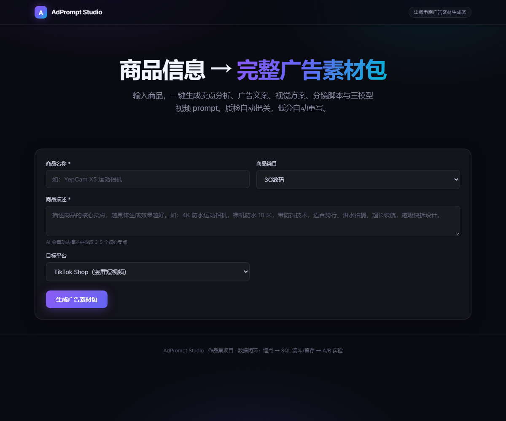
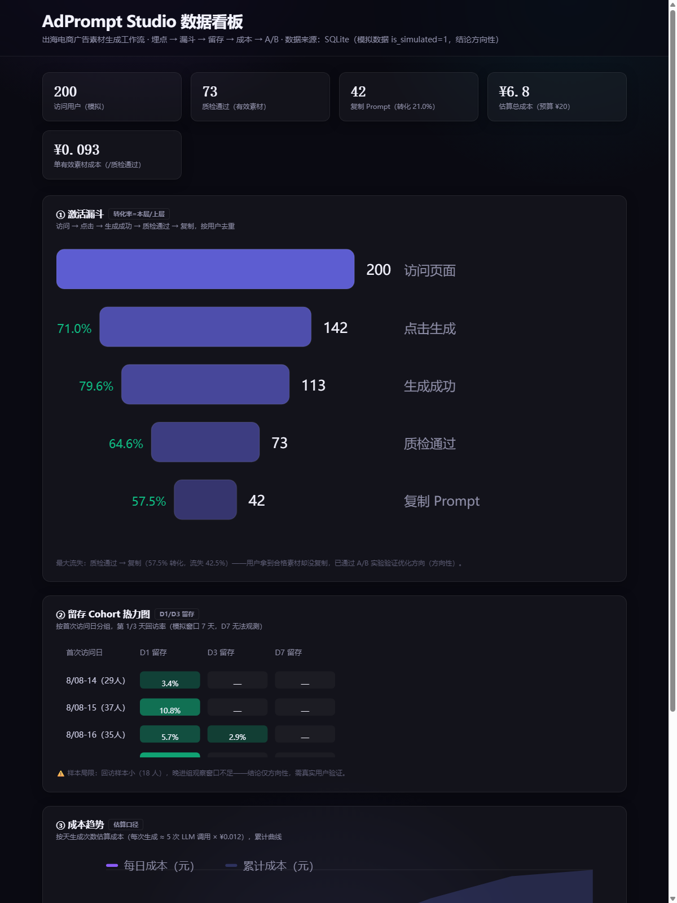

# AdPrompt Studio

**出海电商广告「选品 → 制作 → 投放 → 素材库」一站式工作台**

输入商品信息，一键产出卖点分析、广告文案、视觉方案、分镜脚本与三模型视频 prompt；内置 LLM-as-judge 质检把关，低分自动重写。





---

## 3 分钟看懂

| | |
|---|---|
| **解决什么问题** | 出海中小卖家（TikTok Shop / Amazon）没有设计和视频团队——不会写视频 prompt 导致生成不可控、反复抽卡；不会选品导致预算浪费在错品上；不会投放导致素材好也投不出去；做完没有积累，每次从零开始 |
| **做了什么东西** | 一个覆盖「卖什么 → 怎么做 → 怎么投 → 怎么积累」全链路的五模块产品：选品分析 / 广告制作 / Prompt 优化 / 投放规则 / 素材库 |
| **怎么实现的** | FastAPI 后端 + 自研单页前端 + SQLite 数据层 + 本地 RAG 知识库（400 篇范文 → 分块 → bge-small-zh 512 维 → numpy 检索）+ DeepSeek LLM + LLM-as-judge 质检重写 |
| **怎么验证的** | 埋点 → SQL 激活漏斗 / 留存 cohort → A/B 实验（800 用户 50/50 分组）→ 可视化看板 |
| **结果** | 单有效素材成本 **¥0.093**；激活漏斗 200 访问 → 42 复制，总转化 **21%**；A/B 证伪了「提升质检通过率 = 提升转化」这个直觉假设 |

> 分析数据以模拟数据为主（`is_simulated=1` 标注），用于验证**数据管线正确性**，产品结论仅标「方向性」——见文末 [诚实声明](#诚实声明数据口径)。

**为什么它不是一个「AI demo」**：它同时兑现了四个维度——产品设计（PRD + Gherkin 可验收）、工程设计（多模块工作流 + RAG + 质检重写，含 7 个可拷打的架构决策）、数据验证（埋点 → SQL → A/B → 看板）、商业闭环（单素材成本核算）。

---

## 产品功能全景（五模块，一站式闭环）

```
① 选品分析    品类热度/利润估算/合规检查 → 推荐值得做的 SKU 方向（规则引擎）
   │
② 广告制作    商品信息 → 卖点/文案/视觉/分镜/三模型 prompt → 质检重写（六步工作流）
   │
③ Prompt 优化  贴差的 prompt → RAG 检索最佳实践 → 改进版 + 解释改了什么
   │
④ 投放规则    预算三阶段分配/出价参考/受众定向/素材规格/A-B 计划（规则引擎）
   │
⑤ 素材库      历史素材回看/导出 Markdown/收藏进知识库（数据飞轮，越用越强）
```

## 背景与目标用户

- **目标用户**：出海电商中小卖家（TikTok Shop / Amazon），无专业视频与设计团队
- **核心痛点**：①不会写视频 prompt → 生成不可控 → 反复抽卡；②不会选品 → 广告预算浪费在错品上；③不会投放 → 素材好却投不出去；④做完没有积累 → 每次从零开始
- **价值主张**：把「卖什么 → 怎么做 → 怎么投 → 怎么积累」整条链路，从「从 0 到 1」降维成「从 1 到 1.1」
- **差异化**：面向卖家的**全流程复合产品**（选品/制作/优化/投放/素材库五模块），区别于即梦的通用对话式提示词优化

## 系统架构

```
┌─────────────────────────────────────────────────────────┐
│              前端（FastAPI + 自研单页，五视图）             │
│  ①选品 → ②制作 → ③优化 → ④投放 → ⑤素材库                  │
└──────────────┬──────────────────────────┬──────────────┘
               │ 5 个 API                  │ /api/event
┌──────────────▼──────────────────────────▼──────────────┐
│   后端模块（Python）：                                    │
│  generate(六步工作流) / optimize(RAG改进) / sourcing(选品) │
│  adbuy(投放) / library(素材库) / collect(数据飞轮)        │
│  核心：LLM-as-judge 质检 + 自动重写(≤2轮)                │
└──────────────┬──────────────────────────┬──────────────┘
               │                          │
   ┌───────────▼─────────┐   ┌────────────▼─────────────┐
   │ RAG 知识库（本地）     │   │ SQLite 数据层              │
   │ 400 范文 → 分块 →     │   │ events/generations/       │
   │ bge-small-zh 512维    │   │ ab_events/collected       │
   │ numpy 向量检索         │   │                          │
   └─────────────────────┘   └───────────────────────────┘
```

## 核心能力（六步工作流）

```
商品信息输入
  → ① 卖点分析（AI 自动从描述提取）
  → ② 广告文案（TikTok 短文案 / Amazon 五点描述）
  → ③ 视觉方案（风格 / 色板 / 构图）
  → ④ 分镜生成（6-8 镜头结构化 JSON）
  → ⑤ 多模型模板适配（即梦 / 可灵 / Seedance 2）
  → ⑥ LLM-as-judge 质检（风格匹配 + 可用性，<3.5 自动重写 ≤2 轮）
```

## 数据验证闭环

| 环节 | 做了什么 | 产出 |
|---|---|---|
| 埋点 | 8 类事件（page_view / generate / quality / copy / feedback）落 SQLite | events 表 |
| 漏斗 | 激活漏斗：访问→点击→成功→质检通过→复制，按用户去重 | [sql/01](sql/01_activation_funnel.sql) |
| 留存 | D1/D3/D7 cohort 分析 | [sql/02](sql/02_retention_cohort.sql) |
| 成本 | 总调用 × 单价 / 有效产出 | [sql/03](sql/03_cost_analysis.sql) |
| A/B | 自动重写 vs 手动提示（800 用户 50/50 分组，主指标=复制率） | [docs/AB实验设计.md](docs/AB实验设计.md) |
| 看板 | 漏斗 / cohort 热力图 / 成本趋势 | [build_dashboard.py](scripts/build_dashboard.py) |

## 工程设计决策（7 个可拷打的取舍）

| 决策 | 问题 | 取舍 |
|---|---|---|
| 弃 Streamlit，自研网页 | 默认样式像工具，埋点要 hack | 多 1-2 天换样式可控 + 埋点自然 + 叙事强 |
| 弃 ChromaDB，numpy 检索 | Python 3.13 HNSW 兼容坑（issue #5925） | 1015 条毫秒级足够，最小可行方案 |
| bge-small-zh 本地 embedding | 中文查询映射英文范文 | 零成本 + 数据主权 + 中文 SOTA 小模型 |
| 质检低温度 0.2 | 裁判需稳定可复现 | 低温度换稳定性，阈值 3.5 可调 |
| 成本护栏 ¥0.1/次 | 自动重写多烧钱 | 护栏恶化 → 否决，方法论铁律 |
| 选品/投放用规则引擎 | 确定性判断不值得调 LLM | 可解释 + 零成本，延续「LLM+规则混合」哲学 |
| 数据飞轮（收藏回灌） | 用户认可的好 prompt 要积累 | 👍 素材存 collected 表 → 重建知识库时参与检索 |

## 数据结论（模拟数据，结论方向性）

- **激活漏斗**：200 访问 → 142 点击（71%）→ 113 成功（79.6%）→ 73 质检通过（64.6%）→ 42 复制（57.5%），总转化 21%
- **最大流失点**：「质检通过 → 复制」流失 42.5%——用户拿到合格素材却没复制
- **A/B 实验**：自动重写使质检通过率 +48%（116→172），但主指标复制率仅 +2.4%（p=0.68 不显著）→ 证据不足维持现状；反直觉洞察：通过人数变多稀释复制率，「提升质量」≠「提升转化」
- **成本**：单有效素材成本约 **¥0.093**（估算口径），全项目预算 ¥20 的 35%

## 快速开始

```bash
# 1. 安装依赖
pip install -r requirements.txt

# 2. 配置 DeepSeek API key（.env，已被 .gitignore 排除）
# DEEPSEEK_API_KEY=sk-xxx

# 3. 数据管线（幂等）
python scripts/download_data.py        # 下载公开数据集（走 hf-mirror 镜像）
python scripts/clean_data.py           # 清洗 → 分层抽样 → 落库 SQLite
python scripts/build_knowledge_base.py # 构建 RAG 知识库

# 4. 模拟用户数据（A/B 实验数据）
python scripts/simulate_users.py       # 200 模拟用户（is_simulated=1）
python scripts/run_ab_experiment.py    # A/B 实验（800 用户）

# 5. 启动产品 + 看板
python -m uvicorn src.api:app --port 8000
# 产品: http://127.0.0.1:8000  （五视图：选品/制作/优化/投放/素材库）
# 看板: http://127.0.0.1:8000/dashboard

# 6. 分析
sqlite3 data/adprompt.db < sql/01_activation_funnel.sql
```

**API 一览**：`/api/generate`（制作）· `/api/optimize`（优化）· `/api/sourcing`（选品）· `/api/adbuy`（投放）· `/api/library`（素材库）· `/api/collect`（数据飞轮）· `/api/export/{id}`（导出）· `/api/event`（埋点）

## 目录结构

```
src/        后端核心（api / prompt_templates / quality_judge）
frontend/   单页前端（index.html / dashboard.html）
scripts/    数据管线、知识库构建、A/B 实验、看板生成
sql/        漏斗 / 留存 / 成本分析 SQL
docs/       PRD、A/B 实验设计、成本核算
demo/       产品截图
```

## 诚实声明（数据口径）

- 本项目的分析数据以**模拟数据为主**（`is_simulated=1` 标注，D7 脚本生成 200 用户），结论仅标「方向性」——模拟数据验证**管线正确性**，不验证产品结论
- 真实数据（开发期 + 朋友试用）通过 `is_simulated=0` 区分，复盘报告写明构成
- 成本为估算值（事件表未记精确 token 数），精确计量为迭代项
- 不涉及任何公司数据，全部公开数据集 + 自产数据

## 文档

- [PRD（需求统一，产品设计维度）](docs/PRD.md)
- [A/B 实验设计](docs/AB实验设计.md)
- [成本核算](docs/成本核算.md)
- [数据集说明](data/数据集说明.md)

## License

MIT
